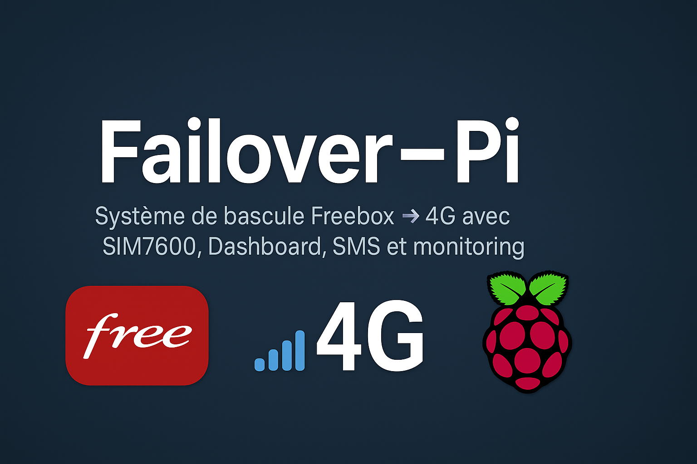
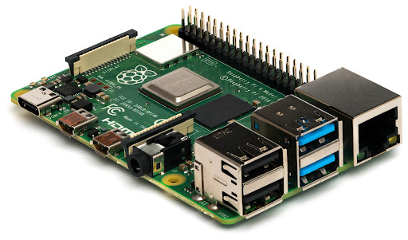

# Failover-Pi  

Système complet de bascule automatique Freebox → 4G (SIM7600E)  
avec Dashboard Web, sauvegardes, restauration et supervision.

---

## 📌 Fonctionnalités principales

### 🟢 **Failover automatique**
- Surveillance en temps réel de la connectivité Freebox  
- Bascule automatique sur la 4G (SIM7600E) si la Freebox tombe  
- Retour automatique Freebox lorsque le réseau revient  
- Journal précis dans `monitor.log` + historique 7 jours

### 🌐 **Dashboard Web (Flask)**
- Statut réseau (Freebox vs 4G)
- Intensité du signal SIM7600E
- Logs en direct
- Graphiques Freebox sur 24h / 7 jours
- Test SMS, reboot 4G, reboot/arrêt du Raspberry Pi
- Backup & restore complet (.zip)
- Gestion utilisateurs (Admin + Users limités)

### 🔐 **Sécurité**
- Authentification complète (login + setup)
- Gestion multi-utilisateurs
- Rôles :  
  - **admin** → accès total  
  - **user** → accès limité (pas d’actions système sensibles)
- HMAC prévu sur scripts sensibles (optionnel)
- Secret key auto-générée → variable systemd

### 📦 **Installation automatique**
- Script d’installation `install_failover_pi.sh`  
  - crée les répertoires  
  - configure les permissions  
  - installe les dépendances  
  - active les services systemd  
  - génère une clé secrète automatique  
  - prépare l’environnement complet

---

## 🔧 Matériel requis

- Raspberry Pi (3, 4, Zero 2 W…)

- Module 4G SIM7600E (USB)

- Carte SIM Free Mobile (APN : `free`)
- Connexion Freebox

---

## 🛠 Installation

Cloner le dépôt :

bash
git clone https://github.com/XAV59213/failover-pi.git
cd failover-pi

Lancer l’installateur :

sudo bash install_failover_pi.sh

Accéder au Dashboard :
http://<IP_du_Pi>:5123

🗂 Sauvegarde & Restauration
Sauvegarde :

→ Générée depuis le Dashboard (zip)
→ Contient :

fichiers Python

config.json

logs

dashboard Flask complet

utilisateurs

scripts

status_history.json

Restauration :

Upload .zip ou restauration d’un backup existant

Le Pi redémarre automatiquement

🔥 Services systemd
Service	Rôle
failover-monitor.service	supervise Freebox + SIM7600E
failover-dashboard.service	interface web Flask

sudo systemctl start failover-monitor
sudo systemctl start failover-dashboard

📡 API interne utilisée

    /sms → test SMS

    /reboot → relance module 4G

    /reboot_pi → reboot Raspberry Pi

    /backup → crée un zip

    /restore → upload ZIP + reboot

    /restore_existing/<name>

    /test_failover

    /clear_logs

👥 Gestion utilisateurs

Rôles :

    admin : accès total

    user : accès restreint

        autorisé : Dashboard, Diagnostics

        interdit : Backup/Restore, reboot, shutdown, gestion utilisateurs
        Le fichier des comptes :
        /home/xavier/.dashboard_users.json

🧪 Diagnostics intégrés

Affiche :

    modules Python

    binaires système

    accès fichiers

    état SIM7600E

    force du signal

    présence ttyUSB0/1/2/3

    services systemd

    permissions

📎 Licence

Projet personnel — utilisation libre.
✨ Auteur

Xavier
        
